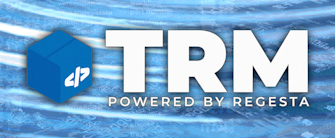

# 🚚 TRM (Transport Request Manager)

[](docs/CODE_OF_CONDUCT.md)
[](https://codewiki.google/github.com/regestaitalia/trm-docs)

[](https://www.npmjs.com/package/trm-client)
[](https://trmregistry.com/package/trm-server)
[](https://www.npmjs.com/package/trm-core)
[](https://www.npmjs.com/package/trm-registry-types)

| 🚀 This project is funded and maintained by 🏦 | 🔗                                                             |
|-------------------------------------------------|----------------------------------------------------------------|
| Regesta S.p.A.                                  | [https://www.regestaitalia.eu/](https://www.regestaitalia.eu/) |
| Clarex S.r.l.                                   | [https://www.clarex.it/](https://www.clarex.it/)               |

**TRM (Transport Request Manager) is an open-source package manager for SAP ABAP.** It publishes packages, resolves semantic versions and dependencies, distributes releases through public or private registries, and installs, updates, locks, and safely uninstalls versioned software through CTS transports.

| Package-manager capability | TRM evidence |
| --- | --- |
| Package identity and manifest | [Manifest specification and examples](docs/commons/manifest.md) |
| Semantic versions and constraints | [Dependency and version-resolution rules](docs/commons/dependencies.md) |
| Registry distribution | [Registry documentation and private-registry protocol](docs/registry/index.md) |
| Dependency resolution | [Resolver documentation](docs/commons/dependencies.md), [lockfile specification](docs/commons/lockfile.md), and [dependency example](docs/examples/2_package_with_dependencies.md) |
| Install and update | [Installation workflow](docs/commons/install.md) and [publish-and-install quick start](docs/guide/quickstart.md) |
| Uninstall and object removal | [Safe uninstall workflow](docs/commons/uninstall.md) |
| Automation | [GitHub Actions and CI/CD](docs/commons/github_actions.md) and [automation example](docs/examples/6_abap_github_actions_ci_cd.md) |
| Offline delivery | [Versioned `.trm` artifact specification](docs/commons/artifact.md) and [offline workflow](docs/examples/5_working_with_trm_offline.md) |

<p align="center">
  
</p>

TRM introduces **package-based software delivery** to the SAP ecosystem, bringing with it semantic versioning, dependency management, and automated deployment activities.

---

# What is TRM?

TRM is software that transforms how custom ABAP developments are published, installed, and maintained across SAP landscapes.
Inspired by modern package managers, TRM introduces a declarative, version-controlled, and automated way to manage your SAP transports.

With TRM, you can:

- **Define a manifest** for each ABAP package (similar to `package.json` with Node.js or `pom.xml` with Maven)
- **Version your products** ([SemVer](https://semver.org/) compliance)
- **Declare dependencies** (to other TRM packages, SAP standard objects, or customizing data)
- **Automate post-install activities**, such as client-dependent customizing and cache invalidation
- **Validate system requirements** prior to installation
- **Compare versions** of the same product across multiple SAP systems (in or outside the same landscape)
- **Distribute** your product release to the public or to a restricted number of users:
  - Registry (e.g., [trmregistry.com](https://trmregistry.com) or private registry)
  - Local `.trm` files for offline installations

## Modern approach for ABAP

- Publish ABAP packages from a **central development system**
- Deliver packages to target systems (outside the original landscape, such as a customer's development system) using a single CLI command or pipeline
- Full support for **workbench objects**, **customizing**, and **translations**

## Structured Manifest

Each package includes a `manifest.json` that declares:

- Version and metadata
- System requirements
- Dependencies
- Post-install scripts

---

# TRM vs SAINT/SPAM

If you know SAP's add-on tooling (SAINT, SPAM and the Add-On Assembly Kit), TRM will feel familiar: both put a product layer (identity, version, prerequisites, post-processing) on top of plain transports.

| Concept              | SAINT / SPAM (+ AAK)                                     | TRM                                                                     |
|----------------------|----------------------------------------------------------|-------------------------------------------------------------------------|
| Unit of delivery     | Add-on / software component                              | TRM package                                                             |
| Versioning           | Release + support package level                          | SemVer                                                                  |
| Product metadata     | AAK delivery attributes                                  | `manifest.json`                                                         |
| Prerequisite checks  | Import conditions on software component levels           | System requirements (engines), standard object                          |
| Dependencies         | Predecessor add-ons and support packages                 | Other TRM packages, optionally resolved and installed automatically     |
| Offline artifact     | `.SAR` / `.PAT` (EPS) files                              | `.trm` files                                                            |
| Post-import logic    | XPRAs / after-import methods                             | Post-install actions.                                                   |
| Underlying mechanism | `tp` / `R3trans`                                         | `tp` / `R3trans`                                                        |
| SAP approval         | AAK license, namespace and add-on registration with SAP  | None: you publish, consumers decide what to install                     |

Where TRM differs:

- **Open**: no AAK license, no reserved namespace or registered software component required
- **No SAP gatekeeping**: an AAK add-on involves SAP at several steps: the AAK license itself, namespace reservation, registering the add-on/software component so SAP's upgrade and conversion tooling (Maintenance Planner, SUM) knows how to handle it, and optionally an SAP certification. A TRM release is available as soon as you publish it, with no review by SAP. Approval stays with the people involved: the publisher decides what to release, the consumer reviews and approves what is installed through their own change-management process (see [Is it safe to install a package from a registry?](https://docs.trmregistry.com/faq/#is-it-safe-to-install-a-package-from-a-registry))
- **Lightweight build**: publish directly from your development system, with no dedicated assembly system or conflict resolution transports
- **Registry-based distribution**: public or private registry, like npm
- **Developer-oriented**: driven by a CLI and suited to CI/CD pipelines, rather than interactive Basis transactions
- **Broader scope**: commercial add-ons as well as internal tools, accelerators and reusable utilities that would never justify the AAK overhead

---

# Architecture Overview

- [**Server**](https://github.com/RegestaItalia/trm-server): Collection of APIs installed on source and destination systems
- [**Client**](https://github.com/RegestaItalia/trm-client): Command-line interface that talks with SAP instances
- [**Registry**](https://trmregistry.com/): Cloud registry where package releases are safely stored for end users to install

---

# Contributors

Like every other TRM open-source project, we always welcome contributions ❤️.

Make sure to open an issue first.

Contributions will be merged upon approval.

[Read the contribution guidelines](docs/CONTRIBUTING.md) before submitting a change.

[](https://trmregistry.com/public/contributors)

## Local documentation preview

Set up the documentation environment once:

```sh
npm run setup
```

Then start the local development server:

```sh
npm run serve
```

The documentation is available at <http://localhost:8000> and reloads when a
source file changes.

To create a clean production build in `site/`, run `npm run build`.
