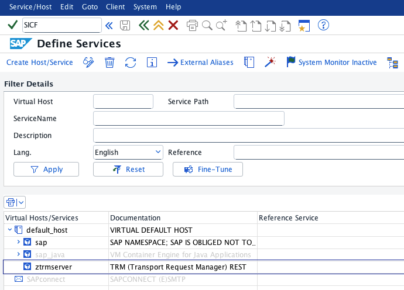

# Client setup

**trm-client** is the client component of TRM.

It acts as the CLI bridge between the **user** and **TRM server**.

---

# Install via npm

After installing [Node.js and npm](https://nodejs.org/en/download), install [trm-client](https://www.npmjs.com/package/trm-client) from npm:

```bash
npm install -g trm-client
```

## Connect to SAP via REST

REST is available immediately after installing the client; no additional step is required. The SAP system must have both [trm-server and trm-rest installed](../server/setup.md).

When prompted for the connection, select REST and enter the SAP system address and HTTP port.

If you do not know the address or port:

1. Open transaction `SICF` in the SAP system.
2. Navigate to `default_host` > `sap` > `ztrmserver`.
3. Right-click `ztrmserver` and select **Test Service**.
4. Use the address and port from the URL that opens in your browser.

<p align="center">
    
</p>

## Connect to SAP via BTP

SAP BTP is the preferred connection method, especially in CI/CD environments, because traffic reaches the SAP system through SAP's secure connectivity channels.

To connect to an SAP system through a destination exposed by SAP BTP, install the prerequisites for [trm-plugin-btp-dest](https://github.com/RegestaItalia/trm-plugin-btp-dest), then run:

```bash
npm install -g trm-plugin-btp-dest
```

BTP should now be available as an option when trying to connect to a system.

See [Connect through SAP BTP](btp_destination.md) for the one-time BTP setup and for connecting without prompts, for example from [GitHub Actions](../commons/github_actions.md).

## Connect to SAP via RFC

### Using SAP RFC SDK

> ⚠️ **Note**: The `node-rfc` library is deprecated. It still works, but RFC connection support is moving to `open-rfc` (See below).

To connect to an SAP system through RFC, install the prerequisites for [node-rfc](https://github.com/SAP-archive/node-rfc), then run:

```bash
npm install -g node-rfc
```

RFC should now be available as an option when trying to connect to a system.

### Using open-rfc

> ⚠️ **Note**: The `open-rfc` connection is experimental. You can try it, but it is not recommended for production use.

To connect to an SAP system through open-rfc run:

```bash
npm install -g trm-plugin-open-rfc-dest
```

OpenRFC should now be available as an option when trying to connect to a system.
